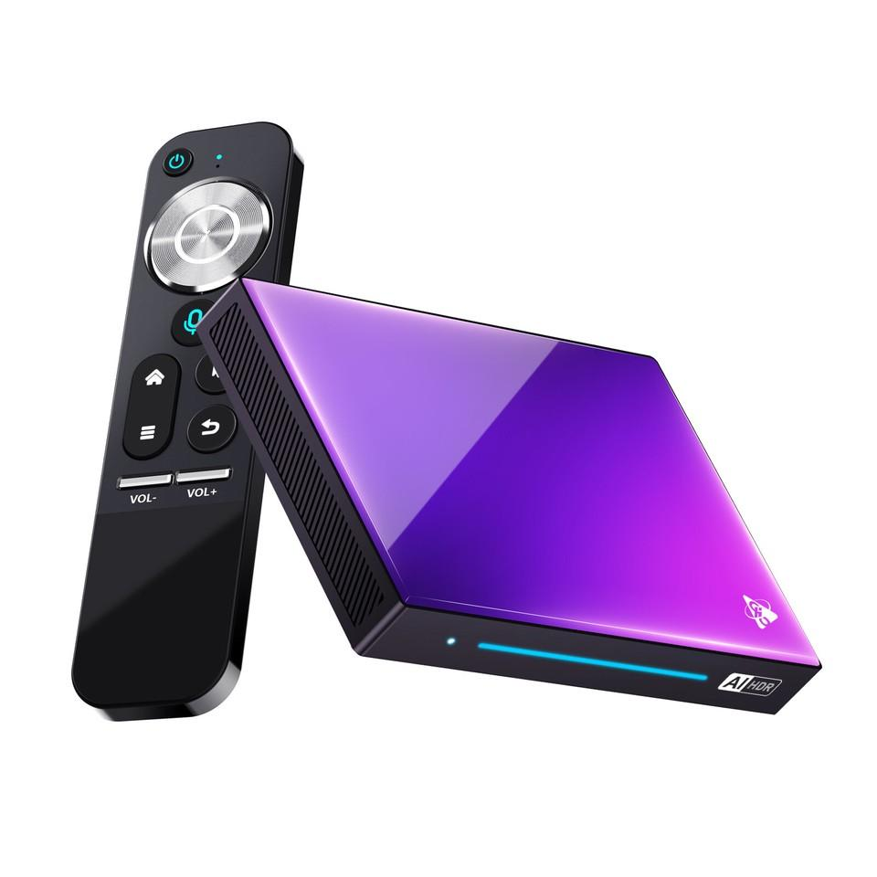
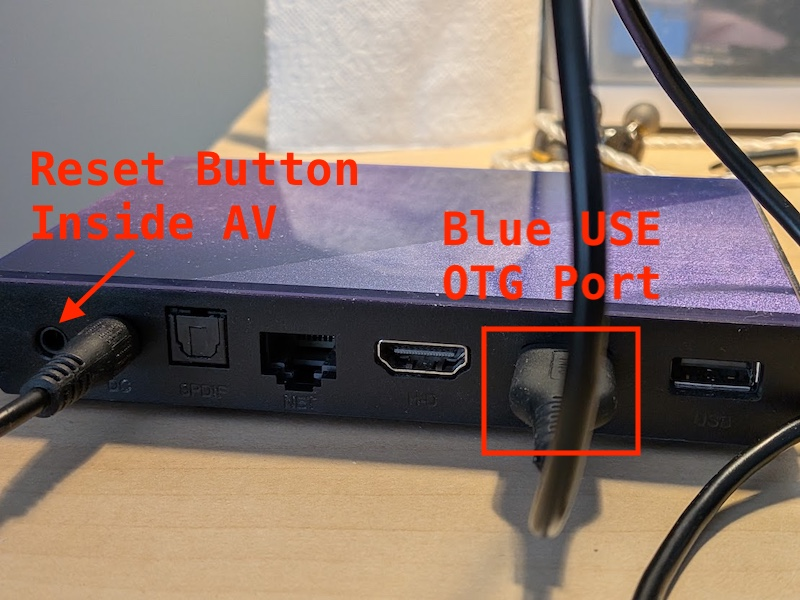
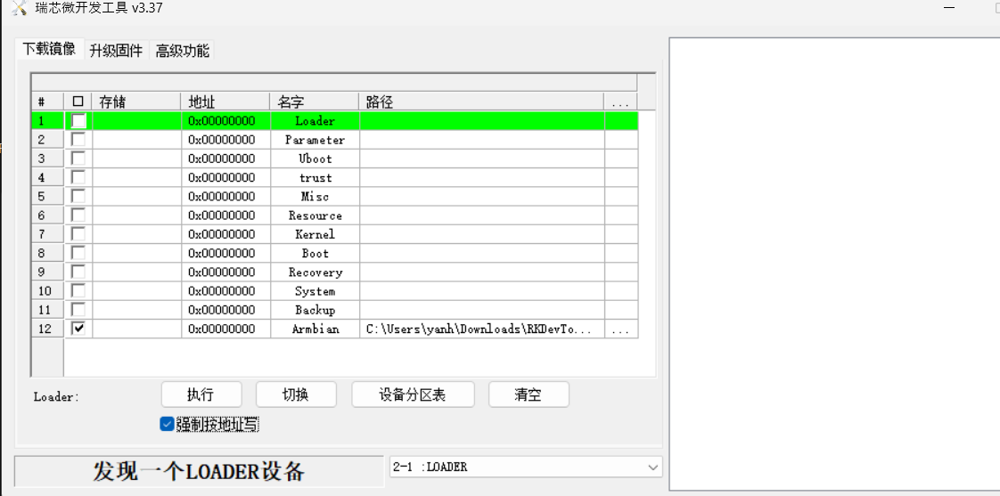
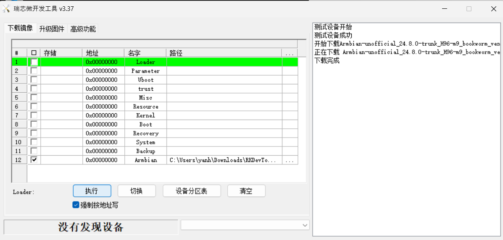

# Installing Armbian on H96 Max M9 (RK3576)

Complete installation guide · Windows + RKDevTool · Debian 12 Bookworm · eMMC installation

This guide documents the installation process we successfully used to replace Android 14 with Armbian on the H96 Max M9 (8GB RAM / 128GB eMMC).

It includes downloading the firmware, preparing Windows, entering Rockchip Loader mode, flashing Armbian, configuring Linux, verifying the hardware, and safely updating Debian while protecting the custom bootloader and kernel.



Installation tested successfully

Armbian-unofficial 24.8.0-trunk · Kernel 6.1.75-vendor-rk35xx

## 1. Hardware compatibility

The following hardware was verified using AIDA64 before installing Armbian.

| Component       | Specification                   |
| --------------- | ------------------------------- |
| Model           | H96 Max M9                      |
| SoC             | Rockchip RK3576                 |
| CPU             | 4 × Cortex-A53 + 4 × Cortex-A72 |
| RAM             | 8GB                             |
| Storage         | 128GB eMMC                      |
| Original OS     | Android 14                      |
| Android build   | `RZX.V01.20240605.1509`         |
| Original kernel | 6.1.57                          |
| Architecture    | ARM64 / AArch64                 |
| Board           | `rk30sdk`                       |
| Device          | `rk3576_box`                    |

This procedure was tested on this hardware configuration. Other H96 Max models or board revisions may require different firmware.

## 2. Required equipment

- H96 Max M9 RK3576 TV box.
- Windows 10/11 computer.
- USB-C to USB-A data cable (or USB-A to USB-A data cable).
- Original H96 Max M9 DC power adapter.
- Nonconductive toothpick for the recessed reset button.
- HDMI monitor or TV.
- USB keyboard.
- Ethernet cable.

The USB-C-to-USB-A cable was successfully tested using a Pixel phone before flashing.

### H96 Max M9 USB connections

[H96 Max M9 TV Box Android 14.0 RK3576 8GB RAM 128GB ROM WiFi6 1000M LAN BT5.4 USB3.0 Support AV1 VP9 4K 60fps H.265 HDR Box User Manual](https://images.openai.com/static-rsc-4/uMJSSE4iR2nRGr5quRNYr6aDqp6poIR9n2Vo5EXWyJtkGX3uP-K-Utc7RBWse79BHLgD7wdIUOw9bE1_0e8_1gBwK2H-AkpuVGaG1c8zyZscu6QCopNO3BYirTcfvhKo85lCs8JHv1UthYxbnU49d9yeUUWz9Zml-QqsWmwrpzY?purpose=inline)

[manuals.plus](https://manuals.plus/asin/B0D7LFC5WX?utm_source=chatgpt.com)

The tested device has two USB-A ports.

| Port          | Purpose                        |
| ------------- | ------------------------------ |
| Blue USB 3.0  | Rockchip OTG flashing port     |
| Black USB 2.0 | Normal USB peripherals         |
| AV socket     | Contains recessed reset button |
| DC            | Power supply                   |
| HDMI          | Display                        |
| NET           | Ethernet                       |

Important: The blue USB 3.0 port was confirmed as the working OTG flashing port on this device.

## 3. Download the required files

### 3.1 Armbian image

Use the revised Armbian image linked by `hzdm` in the September 13, 2024 forum post.

Armbian Bookworm — H96 Max M9

Unofficial 24.8.0-trunk · Debian 12 · Vendor kernel 6.1.75

Armbian-unofficial_24.8.0-trunk_H96-m9_bookworm_vendor_6.1.75.img

 Download revised Armbian imageThis is the revised 2024 image successfully used for this installation. Link availability may change.

The revised image reportedly fixes an earlier U-Boot recovery-button issue.

### 3.2 Factory Android recovery firmware

Download and retain the original Android firmware before replacing it.

[H96 Max M9 factory Android firmware](https://drive.google.com/drive/folders/1g63F8fGSLEA9iK2_Mqzd6F0xfaTRnGlm?utm_source=chatgpt.com)

The following firmware archives were downloaded during our installation:

```
H96_MAX_M9_RZX.V01.20240821.0954.IMG.7z
H96_MAX_M9_RZX.V01.20240930.1433.IMG.7z
```

Extract the archives to obtain the Rockchip firmware images.

These are potential recovery images, but their restoration compatibility was not tested during this installation.

### 3.3 Rockchip flashing tools

Download the Rockchip tools: [RK3566 RK3568 RK3576 RK3588 Products firmware upgrade](https://github.com/industrialtablet/RK3576S-RK3576-RK3588-Tablet-Development-Board/blob/main/RK3576_RK3588_Update_Firmware.md)

Download [RKDevTool_v3.37](https://github.com/industrialtablet/RockChip-Development-Tools/raw/main/RockChip Development Tools/RKDevTool_v3.37_for_window.zip) and [DriverAssistant_v5.14](https://github.com/industrialtablet/RockChip-Development-Tools/raw/main/RockChip Development Tools/DriverAssitant_v5.14.zip)

The installation used:

| Tool                      | Version                    |
| ------------------------- | -------------------------- |
| RKDevTool                 | 3.37                       |
| Rockchip Driver Assistant | 5.14                       |
| RK3576 MiniLoader         | `RK3576_MiniLoaderAll.bin` |

The MiniLoader was retained for recovery; it was not separately flashed in the successful procedure.

## 4. Prepare Windows

### 4.1 Extract the files

Create a working folder such as:

```
C:\H96-M9\
├── Armbian\
│   └── Armbian-unofficial_24.8.0-trunk_H96-m9_bookworm_vendor_6.1.75.img
├── RKDevTool_v3.37\
├── DriverAssistant_v5.14\
├── RK3576_MiniLoaderAll.bin
└── Android-Recovery\
```

Keep the filenames and paths simple.

### 4.2 Install the Rockchip USB driver

1. Open the `DriverAssistant_v5.14` folder.
2. Right-click `DriverInstall.exe`.
3. Select Run as administrator.
4. Click Install Driver.
5. Wait for the successful installation message.

### 4.3 Launch RKDevTool

Run:

```
RKDevTool.exe
```

Before connecting the device, RKDevTool should show:

```
没有发现设备
```

Translation: No device found.

This is expected.

## 5. Enter Rockchip Loader mode

Do not flash or erase anything during this stage.



Follow this procedure:

1. Disconnect the H96 Max M9's DC power.
2. Connect the USB-C end of the data cable to the Windows laptop.
3. Insert a nonconductive toothpick into the AV socket.
4. Press and hold the recessed reset button.
5. While holding reset, connect the USB-A end to the blue USB 3.0 port.
6. If required for detection, connect DC power while continuing to hold reset.
7. Release reset after RKDevTool detects the device.

The successful installation used the blue USB 3.0 port.

### Expected result

LOADER

Device detected

```
发现一个LOADER设备
```

Translation: Found one LOADER device.

If RKDevTool does not detect the device, check the Rockchip driver, USB cable, OTG port, and reset-button procedure.

Do not proceed until the device is detected.

## 6. Verify the Armbian image

Before flashing, verify that the image is readable and contains the expected disk structure.

### 6.1 Calculate SHA-256

Open PowerShell:

```
Get-FileHash `
  -Path "C:\H96-M9\Armbian\Armbian-unofficial_24.8.0-trunk_H96-m9_bookworm_vendor_6.1.75.img" `
  -Algorithm SHA256
```

Save the result for future reference. A checksum from a trusted source would be needed to independently verify the download.

### 6.2 Verify the GPT header

```
$Image = "C:\H96-M9\Armbian\Armbian-unofficial_24.8.0-trunk_H96-m9_bookworm_vendor_6.1.75.img"

$fs = [System.IO.File]::OpenRead($Image)

try {
    $fs.Position = 512
    $buffer = New-Object byte[] 8
    $null = $fs.Read($buffer, 0, 8)

    [System.Text.Encoding]::ASCII.GetString($buffer)
}
finally {
    $fs.Dispose()
}
```

Expected:

```
EFI PART
```

This confirms the presence of a GPT header.

### 6.3 Verified partition layout

The successfully installed image contained:

| Property        | Value    |
| --------------- | -------- |
| Partition table | GPT      |
| Partition       | `rootfs` |
| Starting LBA    | 32768    |
| Ending LBA      | 4628446  |
| Partition size  | 2244 MiB |
| Rootfs offset   | 16 MiB   |

The image also contained boot-related data at 32 KiB and an FDT signature at 8 MiB.

These findings are consistent with a Rockchip bootable disk image, although they do not independently validate the bootloader.

## 7. Flash Armbian to eMMC

This operation overwrites Android on the internal eMMC.

### 7.1 Configure RKDevTool

Open the 下载镜像 (Download Image) tab.

Create a row for the complete Armbian `.img` file.

| Setting       | Value          |
| ------------- | -------------- |
| Name          | `Armbian`      |
| Address       | `0x00000000`   |
| File          | Armbian `.img` |
| Row enabled   | Yes            |
| Other rows    | Unchecked      |
| 强制按地址写  | Checked        |
| Device status | LOADER         |

In the tested setup, Armbian was configured on row 12. The row number itself is not important; the selected image, address, and checkboxes are.

RKDevTool configuration summary

Image

Armbian

Start address

0x00000000

Force Write by Address

Loader mode

Detected

Do not enable the separate `Loader`, `uboot`, `boot`, or other partition rows.



### 7.2 Execute flashing

1. Verify the Armbian image path.
2. Confirm the device is still in LOADER mode.
3. Click 执行 (Execute).
4. Wait for RKDevTool to complete writing the image.
5. Do not disconnect the cable or interrupt power during the operation.

### 7.3 Verify completion



The successful operation ended with:

```
下载完成
```

Translation: Download/write completed.

RKDevTool subsequently displayed:

```
没有发现设备
```

This was normal for our installation because the device disconnected after flashing.

A completed write does not guarantee a bootable system; the next stage verifies startup.

## 8. First boot into Armbian

After flashing:

1. Disconnect the USB cable from Windows.
2. Disconnect DC power from the H96 Max M9.
3. Connect HDMI to a monitor or TV.
4. Connect Ethernet to your network.
5. Connect a USB keyboard.
6. Reconnect DC power.
7. Do not press the reset button during normal boot.

The tested installation successfully displayed:

```
Armbian-unofficial 24.8.0-trunk Bookworm tty1

h96-m9 login:
```

### 8.1 Initial login

Use:

```
Username: root
Password: 1234
```

Armbian normally requires changing the root password immediately.

Then complete the first-login wizard, including creating a regular user.

In our installation:

```
Username: yanh
Shell: ZSH
Locale: en_CA.UTF-8
Timezone: America/Edmonton
```

Choose your own username and settings as appropriate.

## 9. Verify the installed system

### 9.1 Operating system and kernel

```
cat /etc/os-release
uname -r
cat /etc/armbian-release
```

Expected kernel:

```
6.1.75-vendor-rk35xx
```

### 9.2 Storage

```
lsblk
df -h /
```

The tested installation reported:

```
mmcblk2       116.5G disk
└─mmcblk2p1   115.3G part /
```

The root filesystem expanded automatically to use the available eMMC storage.

### 9.3 Memory

```
free -h
```

Observed:

```
Mem:   7.7Gi
Swap:  3.9Gi
```

Armbian configured compressed zram swap automatically.

### 9.4 Networking

```
ip -br addr
ip route
ping -c 4 1.1.1.1
ping -c 4 one.one.one.one
```

The tested device received:

```
192.168.0.122
```

IPv6 connectivity was also verified.

### 9.5 SSH access

From Windows PowerShell:

```
ssh yanh@192.168.0.122
```

Replace the username and IP address with your own values.

### 9.6 Temperature sensors

```
for zone in /sys/class/thermal/thermal_zone*; do
    printf '%s: ' "$(cat "$zone/type")"
    awk '{printf "%.1f°C\n", $1/1000}' "$zone/temp"
done
```

Observed idle temperatures:

| Sensor           | Temperature |
| ---------------- | ----------- |
| SoC              | 31.5°C      |
| Big CPU cores    | 31.5°C      |
| Little CPU cores | 31.5°C      |
| DDR              | 30.5°C      |
| NPU              | 31.5°C      |
| GPU              | 31.5°C      |

These are idle measurements, not sustained-load results.

## 10. Protect the custom Armbian boot components

This installation uses an unofficial board-specific kernel and bootloader.

Do not blindly upgrade the Armbian kernel or U-Boot.

First, identify the installed packages:

```
dpkg -l 'linux-image*' 'linux-dtb*' 'linux-u-boot*' |
    grep '^ii'
```

The tested installation used:

```
linux-image-vendor-rk35xx     24.8.0-trunk
linux-dtb-vendor-rk35xx       24.8.0-trunk
linux-u-boot-h96-m9-vendor    24.8.0-trunk
```

### 10.1 Hold the board-specific packages

```
sudo apt-mark hold \
  armbian-bsp-cli-h96-m9-vendor \
  armbian-firmware \
  armbian-plymouth-theme \
  armbian-zsh \
  base-files \
  linux-image-vendor-rk35xx \
  linux-dtb-vendor-rk35xx \
  linux-u-boot-h96-m9-vendor \
  initramfs-tools \
  initramfs-tools-core
```

Verify:

```
apt-mark showhold
```

These ten holds preserve the tested boot stack and related packages during normal APT upgrades. The holds on `base-files`, `armbian-zsh`, `armbian-plymouth-theme`, and `initramfs-tools` are conservative precautions and should be reviewed periodically rather than treated as permanent security policy.

## 11. Verify the boot configuration

The tested H96 Max M9 image uses U-Boot with extlinux.

Inspect:

```
cat /boot/extlinux/extlinux.conf
```

The working configuration was:

```
label Armbian-unofficial
  kernel /boot/Image
  initrd /boot/uInitrd
  fdt /boot/dtb/rockchip/h96-m9_original.dtb
  append root=UUID=0f868e6c-f3d7-4164-812a-c19a181802e2  rw no_console_suspend consoleblank=0 fsck.fix=yes fsck.repair=yes net.ifnames=0 splash plymouth.ignore-serial-consoles
```

The root UUID is specific to this installation. Do not copy it to a different image or filesystem without verifying the actual UUID using `blkid`.

The important H96-specific entry is:

```
fdt /boot/dtb/rockchip/h96-m9_original.dtb
```

This selects the device tree used by the successfully booted image.

## 12. Back up the working boot files

Before upgrading Debian, create a backup:

```
sudo tar -C / -czpf \
  /root/h96-m9-boot-backup.tar.gz \
  boot
```

Verify:

```
sudo tar -tzf /root/h96-m9-boot-backup.tar.gz |
  grep -E 'extlinux.conf|h96-m9_original.dtb|uInitrd|vmlinuz'
```

Copy it to your regular user's home directory:

```
sudo install -o "$USER" -g "$(id -gn)" -m 600 \
  /root/h96-m9-boot-backup.tar.gz \
  "$HOME/h96-m9-boot-backup.tar.gz"
```

Then copy it to Windows:

```
scp yanh@192.168.0.122:/home/yanh/h96-m9-boot-backup.tar.gz "$env:USERPROFILE\Downloads\"
```

This backs up the files under `/boot`, including the kernel, device trees, initramfs, and extlinux configuration. It does not capture the Rockchip bootloader stored in raw eMMC sectors.

Keep the original working Armbian `.img` file for disaster recovery.

## 13. Update Debian 12 safely

The 2024 Armbian image contained older Debian Bookworm packages.

After running:

```
sudo apt update
```

APT reported approximately 175 available upgrades.

Some available Armbian packages were from a much newer 26.8 release, so we protected the custom boot components before proceeding.

### 13.1 Simulate the upgrade

```
sudo apt-get -s upgrade
```

Check for potentially dangerous operations:

```
sudo apt-get -s upgrade |
  grep -E 'upgraded,|^Remv |^Inst (armbian|linux-image|linux-dtb|linux-u-boot|initramfs|base-files)'
```

The final verified simulation showed:

```
148 upgraded, 0 newly installed, 0 to remove and 8 not upgraded.
```

No protected boot components were selected for upgrading.

### 13.2 Perform the upgrade

After verifying the package holds and backing up `/boot`:

```
sudo apt update
sudo apt upgrade
```

Keep an HDMI monitor and keyboard available. Updates to NetworkManager, OpenSSH, and systemd may temporarily interrupt remote access.

Do not automatically overwrite customized configuration files without reviewing the changes.

### 13.3 Verify before rebooting

```
echo "=== Kernel ==="
uname -r

echo "=== Boot files ==="
readlink -f /boot/Image
readlink -f /boot/uInitrd
readlink -f /boot/dtb

echo "=== Boot configuration ==="
cat /boot/extlinux/extlinux.conf

echo "=== Package holds ==="
apt-mark showhold

echo "=== Failed services ==="
systemctl --failed
```

The actual post-upgrade checks confirmed:

- Kernel remained `6.1.75-vendor-rk35xx`.
- Kernel, initramfs, and DTB symlinks still resolved correctly.
- extlinux configuration remained unchanged.
- All ten package holds were present.
- Zero failed systemd services.

### 13.4 Reboot and verify

```
sudo reboot
```

After reconnecting:

```
uname -r
uptime
systemctl --failed
df -h /
ip -br addr
```

The reboot should be treated as the final validation of the upgrade. The recorded session confirms the pre-reboot checks; it does not yet include a verified post-upgrade reboot result.

## 14. Troubleshooting

| Symptom                               | Recommended check                                            |
| ------------------------------------- | ------------------------------------------------------------ |
| RKDevTool reports no device           | Confirm driver, blue USB 3.0 OTG port, cable, and reset procedure |
| Device detected as MASKROM            | Stop and verify the appropriate recovery-loader procedure    |
| Flash fails                           | Save the RKDevTool log; do not repeatedly erase or flash     |
| HDMI remains black                    | Check DHCP leases and SSH before reflashing                  |
| Armbian reaches login but no Ethernet | Check `ip -br addr`, `ip route`, and NetworkManager          |
| Root filesystem remains small         | Check `lsblk` and `df -h /` before resizing                  |
| System fails after package upgrade    | Use HDMI or serial diagnostics; preserve the original boot image |
| Wi-Fi or Bluetooth missing            | Check board revision and firmware support; Ethernet is the verified connection |

## 15. Final installation checklist

Installation progress

12 / 13

Confirmed RK3576 / 8GB / 128GB hardware

Downloaded revised September 13, 2024 Armbian image

Downloaded factory Android recovery firmware

Installed Rockchip USB driver and RKDevTool

Detected device in LOADER mode through blue USB 3.0 port

Flashed complete Armbian image to eMMC

Booted Debian 12 Bookworm successfully

Created regular user and enabled SSH

Verified eMMC expansion, RAM, networking, and temperature sensors

Held ten boot-sensitive packages

Backed up working /boot files

Completed Debian userspace upgrade and pre-reboot checks

Verified successful reboot after upgrading

## References

The primary reference is the [Armbian community development thread for H96 Max M9 RK3576](https://forum.armbian.com/topic/40483-efforts-to-develop-firmware-for-h96-max-m9-rk3576-tv-box-8g128g/?utm_source=chatgpt.com).

The September 13, 2024 revised image and the later Windows RKDevTool flashing instructions informed this procedure. The actual settings, hardware measurements, and successful installation results were verified during our installation session.

Result: The H96 Max M9 is running Debian 12 Bookworm on Armbian unofficial 24.8.0-trunk, using the RK3576 vendor kernel 6.1.75, with its internal eMMC, Ethernet, SSH, and thermal sensors operational.